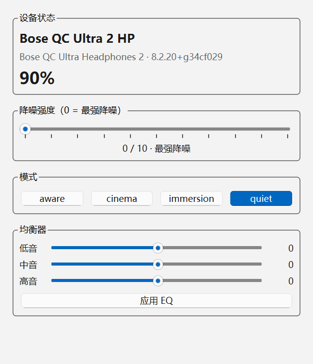

# bosectl-gui

[](#)
[](LICENSE)
[](#)

**在 Windows 上直接控制 Bose 耳机 —— 系统托盘常驻，无需 Bose Music 手机 App、无需账号、无需云端。**

bosectl-gui 是一个中文界面的 Windows 托盘应用：实时电量、降噪强度（CNC 0–10 滑杆）、
聆听模式切换、三频 EQ 调节，全部通过蓝牙 RFCOMM 直连耳机完成。

> 基于 [aaronsb/bosectl](https://github.com/aaronsb/bosectl) 的 BMAP 协议实现
> （pybmap），并为其新增了完整的 Windows 传输层与设备发现层。协议逆向与研究
> 成果归上游项目所有，详见其 [NOTES.md](https://github.com/aaronsb/bosectl/blob/main/NOTES.md)。

## 功能

- **托盘常驻** —— 电量随tooltip/轮询更新（60s），右键菜单直接切换降噪档位与聆听模式
- **降噪强度** —— CNC 0–10 滑杆（0 = 最强降噪），主窗口与托盘菜单均可调
- **聆听模式** —— Quiet / Aware 等设备预设一键切换
- **三频 EQ** —— 低音/中音/高音独立滑杆，实时应用
- **ANR 模式**（QC35 等老设备）—— 关闭 / 低 / 高 / 防风
- **状态总览** —— 型号、固件版本、电量（含多电池组件：耳罩/充电盒）
- **断线自动重连** —— 耳机休眠/走远后 15s 重试，恢复后自动刷新
- **按设备能力自适应** —— 无 EQ 或无模式功能的设备自动隐藏对应控件

## 截图

<p align="center">
  
</p>

## 下载安装

### 方式一：Release 直接下载（推荐）

**[⬇ 下载 bosectl-gui-v0.1.0.exe](https://github.com/redtecher/bosectl-gui/releases/download/v0.1.0/bosectl-gui-v0.1.0.exe)**
（单文件，约 8.4 MB，双击即可运行，无需安装）

更多版本见 [Releases](https://github.com/redtecher/bosectl-gui/releases)。

**系统要求**：Windows 10（1903+）或 Windows 11，蓝牙开启，耳机已在系统中配对
（设置 → 蓝牙和其他设备）。

### 方式二：源码运行

```powershell
git clone https://github.com/redtecher/bosectl-gui.git
cd bosectl-gui
python -m pip install PySide6-Essentials==6.8.3   # 见下方"已知环境问题"
python -m gui
```

## 使用

- **启动后**：主窗口自动打开，耳机连接后显示完整状态
- **关闭主窗口**：程序缩小到托盘继续运行（不会退出）
- **托盘左键单击**：重新打开主窗口
- **托盘右键**：降噪档位（0–10）、模式切换、退出
- **CNC 滑杆**：拖动松开后自动应用（0 = 最强降噪，10 = 几乎通透）

## 打包 EXE

```powershell
python -m pip install pyinstaller
cd gui
python resources.py            # 生成 resources/icon.ico
pyinstaller bosectl-gui.spec
# 产物: gui/dist/bosectl-gui.exe（单文件 windowed）
```

打包后自检（需已配对的真机；CNC 写入/恢复往返，退出码 0 = 通过）：

```powershell
.\dist\bosectl-gui.exe --smoke
echo %ERRORLEVEL%
```

## 支持的设备

设备支持继承自 pybmap 设备目录，Windows 下按注册表 BTHENUM VID/PID 自动识别：

| 设备 | Windows 验证情况 |
|---|---|
| **QuietComfort Ultra Headphones 2**（qc_ultra2） | ✅ 真机全功能验证（电量/模式/CNC/EQ） |
| QuietComfort Ultra Headphones（lonestarr） | 继承上游配置，未在 Windows 验证 |
| QuietComfort Headphones（prince） | 继承上游配置，未在 Windows 验证 |
| QuietComfort 45 / QC35 / QC Earbuds 系列 | 继承上游配置，未在 Windows 验证 |

未知 PID 自动回退 qc_ultra2 配置。欢迎在
[Issues](https://github.com/redtecher/bosectl-gui/issues) 反馈其它型号的实测结果。

## 工作原理

```
托盘/主窗口 (PySide6, UI 线程)
      │  queued signal/slot
      ▼
DeviceService (worker QThread)
      ▼
pybmap — BMAP 协议 (SETGET/START 操作符, 无需认证)
      ▼
Winsock AF_BTH RFCOMM (ctypes, channel 2)
      ▼
Bose 耳机
```

- **协议**：BMAP（Bose Media Application Protocol），4 字节头 + payload 的二进制协议。
  设置类操作走未鉴权的 SETGET 操作符 —— 不是漏洞利用，不提取密钥，不重放流量。
- **传输层**：Winsock `AF_BTH`/`BTHPROTO_RFCOMM`，紧凑 30 字节 `SOCKADDR_BTH`，
  非阻塞 connect + select 限时，WSA 错误码映射到与 Linux 一致的重试语义。
- **发现层**：`bthprops.cpl` 枚举已配对设备 + 注册表 `BTHENUM` 服务实例键确认
  BMAP 能力与型号 PID。
- **线程模型**：所有蓝牙 IO 在独立 QThread，UI 永不阻塞。

详见上游 [architecture 文档](https://github.com/aaronsb/bosectl/blob/main/docs/architecture.md)。

## 开发

```powershell
# 单元测试（285 passed / 50 skipped，无需真机）
python -m pytest tests/ -q

# 真机冒烟测试（连接 → 快照 → CNC 写 3 → 回读 → 恢复 0 → 退出码判定）
python -X utf8 -m gui.smoke_test
```

### 已知环境问题

- **PySide6 ≥ 6.9 与 Anaconda 冲突**：PATH 中 conda 的旧版 `icuuc.dll` 会导致
  `Qt6Core` 加载失败（WinError 127）。源码运行请固定
  `PySide6-Essentials==6.8.3`，或使用干净的 Python 环境。打包后的 EXE 不受影响。
- 打包入口是 `gui/run.py`（顶层脚本）：PyInstaller 下 `__main__.py` 的相对导入不解析。

## 项目结构

```
├── gui/
│   ├── app.py           # 托盘控制器 + 组装（TrayController: QObject）
│   ├── service.py       # DeviceService: 蓝牙 worker 线程
│   ├── main_window.py   # 主窗口（状态/CNC/模式/EQ）
│   ├── resources.py     # 程序化生成图标（QPainter，无版权素材）
│   ├── smoke_test.py    # 真机冒烟测试
│   ├── run.py           # PyInstaller 打包入口
│   └── bosectl-gui.spec
├── pybmap/              # BMAP 协议库（含 Windows 传输/发现层）
└── tests/               # 单元测试
```

## 版本

- **v0.1.0**（2026-11-03）：首个发布。Windows 传输层/发现层、中文托盘 GUI、
  单文件 EXE 打包、真机冒烟测试（QC Ultra Headphones 2 全功能验证）。

## 路线图

- **macOS 版本** —— 适配 IOBluetooth 传输层与原生菜单栏（menu bar）常驻，
  提供 .app / dmg 发布
- **Linux 版本** —— 适配 BlueZ D-Bus 传输层与系统托盘（StatusNotifierItem），
  提供 AppImage 发布
- **界面优化** —— 深色/浅色主题跟随系统、托盘电量百分比图标、
  主窗口信息可视化（EQ 曲线、电池分组件进度条）
- **体验优化** —— 开机自启动、多设备切换、快捷键全局调节降噪、
  低电量桌面通知、点击托盘气泡定位耳机

> pybmap 协议库本身已跨平台（Linux/macOS 传输层继承自上游
> [aaronsb/bosectl](https://github.com/aaronsb/bosectl)），跨平台工作主要是
> GUI 层与打包适配。

## 反馈

遇到 bug 或有功能建议，请到
[Issues](https://github.com/redtecher/bosectl-gui/issues) 提交——
附上设备型号、系统版本和复现步骤会更快得到处理。其它型号 Bose 耳机的
实测结果（无论成功与否）同样欢迎在 Issues 反馈。

## 致谢与许可

- 协议实现基于 **[aaronsb/bosectl](https://github.com/aaronsb/bosectl)**
  （MIT License），感谢上游的 BMAP 协议逆向与跨语言实现。
- 本项目图标为 QPainter 程序化绘制，不包含任何 Bose 商标素材。
- "Bose" 与相关产品名称归 Bose Corporation 所有，本项目与其无关联。

## License

MIT — 见 [LICENSE](LICENSE)
